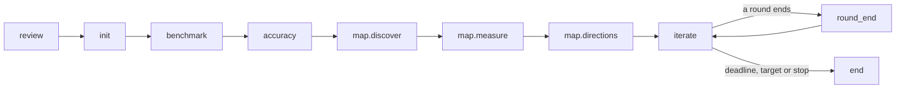
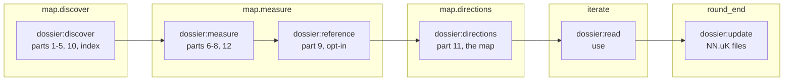
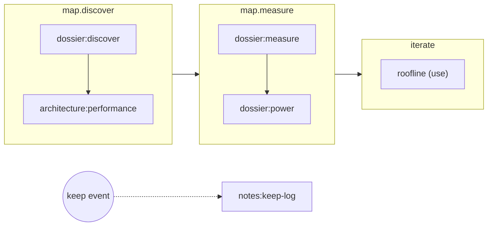

# How skills fit into an Arbor campaign

This page explains, for a person, how Arbor gives its agents their skills: the chapters a session runs through, how
the dossier's work is split across six skills in those chapters, and where a new skill joins them. It is the picture;
[skills.md](skills.md) is the reference for writing one, key by key.

## The short version

- **A session is a sequence of chapters:** review, init, benchmark, accuracy, the map's three chapters, iterate,
  round end and end.
- **A pack decides which skills take part in each chapter,** in one of three ways:
  - Arbor **runs** a skill as a step of the chapter;
  - Arbor **triggers** one when something happens;
  - the chapter's agent may **use** one when it chooses.
- **The dossier,** which used to be one large skill an agent worked through in one go, is now six skills.
  - Each writes its own parts of the dossier, in its own chapter, in its own agent turn.
  - Arbor checks the files each one leaves.
- **A new skill joins by declaring where it can take part.** Arbor orders it, checks it and records it. Nothing is
  placed by a sentence in another skill's text.
- **Skills for developing Arbor itself** form a fourth kind that a campaign never loads.

## A session's chapters



| Chapter | What happens |
| --- | --- |
| `review` | a person reviews the campaign before anything runs (a fresh session only) |
| `init` | the validators are pinned, the workspace seeded, a recorded baseline taken |
| `benchmark` | the benchmark is studied once: its rules, its reference, what to measure |
| `accuracy` | the root's accuracy is measured once |
| `map.discover` | the dossier's reading parts, with no GPU |
| `map.measure` | the dossier's measured parts, on the node |
| `map.directions` | the directions and kernel plans, ending in the map |
| `iterate` | each iteration: the agent's change, then serve, bench, check, gate and record |
| `round_end` | a round's A/B, a rebaseline, and the dossier's update |
| `end` | exit, report and archive |

The list lives in `arbor/lifecycle.py`. Each chapter the session enters is written to its journal,
`<session>/lifecycle.jsonl`, which is what a host such as Hyperloom's multi-branch mode follows.

## Three ways a skill takes part

| | Who starts it | When | Example |
| --- | --- | --- | --- |
| **run** | Arbor | as a step of its chapter, in the order the pack gives, in an agent turn of its own | `dossier:measure` in `map.measure` |
| **trigger** | Arbor | when an event fires (a KEEP, a round's end, the session's end), beside the session | a note at each KEEP |
| **use** | the agent | whenever the chapter's agent finds it useful | `profiler` while iterating |

The difference that matters:
- **A `run` skill is a step that must happen.** Arbor hands it a brief, waits for its turn, checks that the files it
  promised exist, and records it. If a file is missing, the chapter stops there and the next turn picks it up. If its
  files are already there for the same model and framework, it is not run again.
- **A `use` skill is know-how on the shelf.** The agent of the chapters that list it may pick it by its description.
  Nothing checks that it was used.

## The dossier, split

A dossier is everything worth knowing before optimizing one model, workload and GPU: twelve numbered parts and an
index, under `docs/dossier/<name>/`. Until this change, one `dossier` skill held the whole procedure. One agent wrote
every part in one long turn, and nothing but the agent's own diligence said which parts were done.

Now six skills of the `dossier` family (`plugins/dossier/`) share the work:



- **The parts on disk did not change.** Same numbers and file names, so existing dossiers stay valid, and so does
  everything that reads them.
- **The parts table,** `arbor/dossier/parts.py`, says which skill writes which part, and whether a dossier is whole
  without it. Part 9 (a reference platform's traces, which only a person can supply) and part 12 (a fast bench that
  may still be in progress) are optional. The checker, `python3 -m arbor.dossier.check`, reads the table.
- **The iterating agent** gets `dossier:read`, which finds, reads and cites the dossier, instead of the writers' full
  procedure.
- **The old `dossier` skill** stays for one release, for packs that still name it.

### What one map turn looks like

When the session reaches the map and its pack lists `run` skills there, the turn is Arbor's, not the main agent's:

1. **The brief.** Arbor writes one for `dossier:discover` under `<session>/runs/`. It names the dossier's directory,
   the files to write and the campaign's program.
2. **The turn.** Arbor dispatches `/dossier:discover <brief>` as an agent turn of its own. The agent gets that skill
   and the chapter's `use` skills.
3. **The check.** When the turn ends, Arbor checks that every file the skill declared exists.
4. **The record.** It writes a `run` entry to the journal, done or incomplete.
5. **The next skill.** `dossier:measure`, then `dossier:directions`, the same way.
6. **The map.** The last skill's `DIRECTIONS:` line sets the map, and iteration starts from it. A dossier-only pass
   for a host ends there, `mapped`.

A pack turns this on in `pack.yaml`. This is the serving template on the lifecycle:

```yaml
plugins: [benchmark, dossier]
lifecycle:
  benchmark:      {run: ["benchmark:study"]}
  map.discover:   {run: ["dossier:discover"]}
  map.measure:    {run: ["dossier:measure"], use: [profiler]}
  map.directions: {run: ["dossier:directions"]}
  iterate:        {use: ["dossier:read", profiler]}
  round_end:      {run: ["dossier:update"]}
```

A pack without `lifecycle:` works as before: its `skills:` list is offered to the agent in every chapter.

## Where a new skill joins

Ask, in order. The first yes is its place.

| Question | Its place | Example |
| --- | --- | --- |
| Does it write a part every reader of the dossier should find with the others? | a part: a new row in the parts table, written by a dossier skill | power and clocks at the operating point |
| Does it produce something a later chapter needs, once per campaign or round? | a `run` skill in its own family, ordered beside the dossier's writers with `after`/`before` | architecture research before profiling |
| Should it happen when something happens, without holding the session up? | a `trigger` skill on that event | a note at each KEEP |
| Is it know-how the agent should be able to pick while working? | a `use` skill, in the chapters whose agent needs it | a roofline reference while iterating |
| Is it for people working on Arbor, never a campaign? | a `develop` skill, in a family of its own | Arbor's own repository |

The examples in that table, placed (none of them ships with Arbor; they show the shape):



What Arbor holds every skill to, whatever its place:
- **`python3 -m arbor.skillcheck`** reads every skill's front matter. It refuses anything it cannot place: an unknown
  chapter, mode or event, a name that is not its directory's, a missing description.
- **Loading a pack** refuses a pack that would run a skill somewhere its declaration does not allow, or in an order
  its `after`/`before` forbids, or that names a skill no family holds.
- **The test suite** runs the skill check over the repository, so a broken skill fails the build.
- **Nothing turns a skill on by itself.** A pack lists it, so every existing campaign is unchanged until its pack
  opts in.

## Under a host

When Arbor runs as a component of a host (`docs/hosts.md`), the host owns the node, the client and the gate.
- **A pack can say what changes then,** in `component.lifecycle`. It replaces the chapters it names, for example an
  empty `benchmark` chapter when the host's own rules apply.
- **The host follows the journal,** `lifecycle.jsonl`: each chapter entered, each `run` and `trigger`, and each event.
- **A host can register callbacks** for events in its component block.

## Skills for developing Arbor

Developing Arbor needs know-how a campaign must never see. Arbor's own repository keeps it in skills of a fourth
kind, the `develop` mode, in a family a campaign never loads. This copy leaves that family out, since it is not
edited here (`VENDOR.md`).

## Where to read more

- [skills.md](skills.md): the layout, every `metadata.arbor` key, the checks, and a worked example.
- [packs.md](packs.md): the rest of `pack.yaml`.
- [hosts.md](hosts.md): component mode, the journal and callbacks.
- `arbor/lifecycle.py` (chapters, events, modes), `arbor/chapters.py` (run skills), `arbor/triggers.py` (events and
  trigger skills), `arbor/dossier/parts.py` (the parts table), `arbor/skillcheck.py` (the checks).
